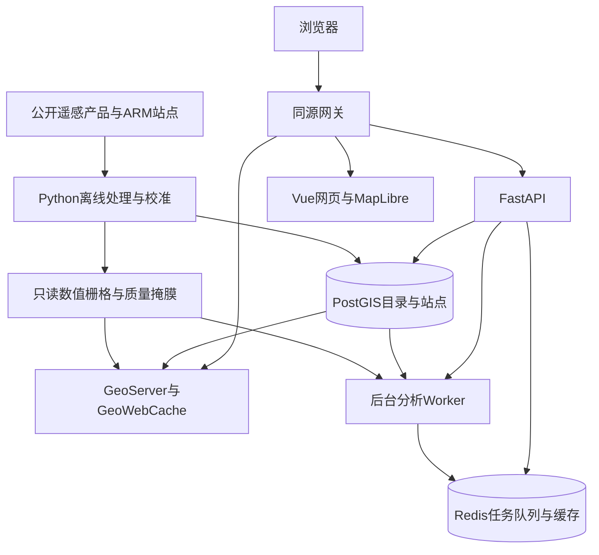

# 地表温度、植被与土壤湿度分析 WebGIS 全栈开发实施文档

范围修订 1.1　更新日期 2026年11月14日

> 当前范围以《项目范围与开发路线.md》为准：本次以公开遥感数据的地图展示、查询、统计、时序、日期对比和导出为主，不要求论文复现、年度微波校准或ARM站点验证。现有EF作为可选派生图层。后文保留的研究章节、年度数据计划和站点验收条目仅作扩展参考，与新范围冲突时不作为必做条件；原作业的工程技术与提交要求仍保留。实际功能状态见requirements.md。

本文件保留原GIS软件工程课程项目的技术实施参考。项目继续围绕遥感地表变量，以MapLibre、FastAPI与按课程要求集成的地图服务提供浏览和空间分析；不把复现文献作为项目成功条件。数据准备、接口、缓存、安全、测试、部署和邮件提交可参考后文，具体范围按新路线执行。

本文是实施规格，功能、接口、命令和目录均为需要开发的约定，不代表已有系统或已有测试结果。示例 JSON 只解释格式；所有科研指标、性能数字和 AI 错误案例必须在实现后据实填写。课程分档不构成得分保证。

交付格式采用Markdown。先阅读《项目范围与开发路线.md》和requirements.md，再选取本文件中相关接口、地图服务、缓存、安全和测试章节；不等待研究算法或站点数据才开发网页。

## 1 项目范围与完成条件

### 1 1 项目目标

开发一个浏览器中的地表温度、植被与土壤湿度分析应用。用户选择日期和变量查看LST、NDVI、SMAP及可选EF，点击查询、绘制区域统计、查看时序、比较日期、导出结果，并追溯来源与质量。

EF 指蒸发分数，是无量纲变量；LST 指地表温度；NDVI 指归一化植被指数；SM 指土壤水分；TVX 指地表温度与植被指数的上下文特征空间。EF 不能直接标注为毫米每天的蒸散发量。

### 1 2 版本安排

| 版本 | 开发内容 | 可以声称的成果 | 进入下一阶段的条件 |
| --- | --- | --- | --- |
| A 样本工程版 | 少量真实日期、经验 TVX 基线、地图、取值、统计 | 基于真实数据的课程原型 | 输入质量可追溯，取值与离线读取一致 |
| B 正式提交版 | 区域统计、时序图、日期对比、导出、服务集成、缓存、安全与性能测试 | 真实公开数据驱动的WebGIS应用 | 功能一致性、工程检查、部署和提交包完成 |
| C 可选研究扩展 | 文献复现、年度校准、站点验证、SM降尺度或ET | 有数据与验证支持的研究结果 | 另行确认研究范围后开展 |

以B工程提交版为目标。A用于排查流程；现有EF继续标为工程基线，无需完成年度校准才能交付WebGIS。第一版不做任意原始文件网页上传、实时遥感处理、深度学习、数字孪生或空间智能体。

### 1 3 与课程要求的对应

| 作业要求 | 本项目实现 | 应保留的证据 |
| --- | --- | --- |
| MapLibre 与 FastAPI 与 GeoServer集成 | 地图服务和数值分析接口同时接入网页 | 架构图、接口文档、操作录像 |
| 人工设计架构与缓存 | 分离批处理和在线请求，GWC与查询缓存 | 设计决策、缓存键、失效测试 |
| CQL注入审查 | 用户条件不直接成为CQL，限制OGC入口 | 恶意输入测试、服务配置 |
| 矢量瓦片审查 | 站点或研究区发布MVT并检查属性和位置 | 扩展版本、MVT检查记录 |
| 投影转换 | 数值网格、查询坐标、展示坐标分开管理 | 控制点与像元一致性记录 |
| 并发和性能优化 | 栅格窗口读取、索引、概览、缓存及负载测试 | 原始结果、环境、前后对比 |
| 代码仓库与人工修改 | 分阶段Git提交、AI协作与真实错误记录 | 仓库、差异、审查日志 |

课程文件对该题未规定 AI 代码比例，不把其他题的50%或60%门槛套用到本题。允许使用 AI 生成代码，但空间逻辑、公式、QA和测试结果必须人工核查。

## 2 用户功能与验收

### 2 1 页面结构

页面左侧为研究区、日期、变量、方法和透明度控制；中央为地图；右侧为像元详情、区域统计或站点验证。较窄屏幕采用抽屉，地图始终保留可用空间。提供单独的数据说明页和系统状态页。

图例标明变量与单位。EF、LST、NDVI使用各自的连续色带；无效像元透明显示并注明原因。EF图例范围固定或明确标注动态范围，避免不同日期颜色相同但含义变化。

### 2 2 功能清单

| 编号 | 功能 | 验收条件 |
| --- | --- | --- |
| F01 | 研究区与底图 | 首屏定位SGP试验区，无外网时仍显示研究区和业务图层 |
| F02 | 日期和方法选择 | 仅列出已发布且状态为ready的数据，显示实际可用日期 |
| F03 | 图层切换 | EF、LST、NDVI可以切换，图例、日期与地图同步 |
| F04 | 像元查询 | 点击显示数值、单位、源像元中心、质量标识与版本 |
| F05 | 区域统计 | 矩形或多边形选择，返回有效像元数、比例、均值和分位数 |
| F06 | 像元时间序列 | 指定位置和时间范围，缺测留空，不用零补齐 |
| F07 | 特征空间 | 抽样显示温度与覆盖度散点、边界和抽样数量 |
| F08 | 站点验证 | 展示配对时间、参考EF、估算EF、样本量及误差指标 |
| F09 | 方法对比 | 同一日期、区域与共同有效掩膜比较基线和优化方法 |
| F10 | 结果导出 | CSV保留单位、数据版本、样本数、掩膜策略和UTC时间 |
| F11 | 来源追溯 | 展示产品、版本、处理参数、方法限制与原始记录编号 |
| F12 | 空状态与失败处理 | 无数据、全缺测、任务失败和服务不可用均有清晰提示 |

本次工程提交以F01至F06、F10至F12以及覆盖率、日期对比为主要功能目标。F07特征空间、F08站点验证和原F09算法对比为可选研究扩展；当前F09改为日期对比，详见requirements.md。矩形与多边形选择可以先后实现。

## 3 技术架构与服务边界

### 3 1 系统组成



离线程序负责读取产品、QA、投影与时间处理、参数校准和EF结果。在线API负责目录、查询、轻量统计、任务管理和导出。CPU密集任务交给Worker，不在FastAPI事件循环里执行年度计算。

### 3 2 技术选择

| 层 | 建议技术 | 决策理由 |
| --- | --- | --- |
| 前端 | Vue 3、TypeScript、Vite、MapLibre GL JS、ECharts | 地图、状态和科研图表职责清楚 |
| 接口 | FastAPI、Pydantic、SQLAlchemy或Psycopg | 类型校验、OpenAPI、参数化查询 |
| 空间处理 | GDAL、Rasterio、PyProj、NumPy、SciPy、pandas | 产品读取、栅格计算、变换与优化 |
| 地图服务 | GeoServer、GeoWebCache、矢量瓦片扩展 | 栅格WMS与瓦片缓存、站点MVT |
| 数据库 | PostgreSQL与PostGIS | 空间对象、数据目录、运行与配对记录 |
| 任务与缓存 | Redis与RQ或同类Worker | 限制重任务并发并复用结果 |
| 网关与部署 | Nginx、Docker Compose | 同源路由、资源限制、便携部署 |
| 测试 | pytest、Playwright、k6或Locust | 算法、接口、页面及负载验证 |

开发时选择一组实际可安装、可启动的版本，写入锁文件和镜像清单；不在Compose中使用latest。GeoServer扩展必须与服务端版本匹配。依赖升级后重跑受影响检查。[R01][R02][R03][R04]

### 3 3 网络与存储

本地开发网页可通过5173端口代理API与OGC。交付演示只开放127.0.0.1:8080，网关分发网页、/api/v1、/maps和/tiles。数据库、Redis、GeoServer管理接口留在内部网络。需公网演示时另行配置HTTPS、鉴权和可访问域名。

栅格保存在数据卷，由GeoServer和分析Worker只读挂载；原始资料不作为公开静态目录。数据库、Redis持久数据和GeoServer配置使用独立卷，版本化配置保存于仓库。

## 4 开发环境与项目目录

### 4 1 环境准备

Windows采用Docker Desktop与WSL2运行服务。建议16GB内存，先为样本预留约20GB空间，再根据实际文件清单估算全年与轨道产品容量；这不是对完整数据规模的保证。前端使用受支持的Node LTS；后端使用与GDAL等依赖兼容的Python版本。最终记录实际版本，不依赖个人机器中的隐式安装。

先做环境冒烟检查：Docker Compose可用；PostGIS扩展可创建；GeoServer健康检查成功；后端能导入GDAL、Rasterio、PyProj；前端能显示一张真实业务图层。HDF4支持需单独测试，某些Rasterio安装不能直接打开全部MODIS原始产品。

### 4 2 目录约定

```text
ef-webgis/
  frontend/                 Vue与MapLibre页面
  backend/app/              API、模型、服务与鉴权
  backend/tests/            单元和接口测试
  processing/               产品适配、预处理、模型、验证
  worker/                   后台分析任务
  configs/                  研究区、产品、QA和方法配置
  infra/                    网关、数据库、GeoServer样式与初始化
  scripts/                  启动、处理、导入、备份和打包
  tests/e2e/                页面测试
  tests/load/               负载脚本
  tests/fixtures/           明确标注的单元测试输入
  data/raw/                 原始文件 不提交Git
  data/interim/             中间数据 不提交Git
  data/processed/           数值结果与质量掩膜
  data/sample/              允许分享的小型真实样本
  manifests/                来源清单、哈希与发布清单
  reports/                  验证、安全、性能及AI协作记录
  docs/                     需求、架构、部署和提交说明
  compose.yaml
  .env.example
  README.md
```

任何路径基于项目根目录或容器挂载目录解析，不硬编码开发者桌面位置。Git忽略.env、令牌、密码、原始大文件、临时产物和本地数据库。

### 4 3 配置与命令约定

配置分为研究区、产品字段映射、QA规则、方法参数与部署环境。每次处理保存完整配置快照和Git提交号。以下命令是需要在scripts目录实现的接口，不是已存在的脚本。

```powershell
Copy-Item .env.example .env
# 编辑 .env 后继续
.\scripts\start.ps1 -Mode sample
.\scripts\ingest.ps1 -Manifest manifests/sample.csv
.\scripts\process.ps1 -Config configs/sample.yaml
.\scripts\publish.ps1 -Release sample-v1
.\scripts\verify.ps1 -Profile sample
.\scripts\package.ps1 -Profile course
```

所有脚本须有参数帮助、退出码、日志和重复执行策略。start先检查环境；ingest验证文件；process失败不发布；publish只接受校验通过的release；package排除凭据。部署脚本不得默认执行清空数据卷。

## 5 研究区年份与数据下载

### 5 1 初始范围

建议研究区为美国南部大平原SGP的子区域：西经98.5度至96.5度、北纬35.5度至37.5度。GeoJSON的bbox写为[-98.5,35.5,-96.5,37.5]，顺序是西、南、东、北。此范围是课程建议，不是论文完整区域。先核查ARM站点和数据覆盖，必要时扩展范围，以保留完整的SMAP单元与足够温湿变化。

2019为正式校准年，2018为可选跨年检验年。先用2019年6月1日至7日打通输入与展示；NDVI样本覆盖2019年5月16日至6月30日。样本7天不能代替年度参数拟合。论文实验采用2019校准、2017至2018检验；严格复现还涉及长期温度约束。[P04]

### 5 2 下载清单

| 数据 | 产品与入口 | 首批下载 | 用途与要求 |
| --- | --- | --- | --- |
| 地表温度 | MOD11A1 V6.1；https://doi.org/10.5067/MODIS/MOD11A1.061 | 2019年6月1日至7日 | LST_Day_1km、QC_Day、Day_view_time；正式阶段补全年 |
| 植被指数 | MOD13A2 V6.1；https://doi.org/10.5067/MODIS/MOD13A2.061 | 2019年5月16日至6月30日 | NDVI、VI质量及可靠性；正式阶段覆盖全年并保留边界时段 |
| 定位与太阳角 | MOD03；https://ladsweb.modaps.eosdis.nasa.gov/missions-and-measurements/products/MOD03 | 先一天匹配过境，再扩至7天 | SolarZenith和定位；与廓线及云产品同次过境 |
| 云与辅助温度 | MOD06_L2；https://ladsweb.modaps.eosdis.nasa.gov/missions-and-measurements/products/MOD06_L2 | 同上 | 根据论文气温方案核实具体SDS，不把云顶温度当地表温度 |
| 温湿廓线 | MOD07_L2；https://ladsweb.modaps.eosdis.nasa.gov/missions-and-measurements/products/MOD07_L2 | 同上 | 估算近地面气温；保留定位和质量信息 |
| 微波土壤水分 | SMAP SPL3SMP 36公里；https://nsidc.org/data/spl3smp/versions/9 | 2019年6月1日至7日 | 上午土壤水分与质量标识；论文用V6，使用V9需说明差异 |
| 站点通量 | ARM EBBR；https://adc.arm.gov/discovery/ | 先查2019覆盖，再下对应时段 | LE、H、UTC时间、QC和站点元数据 |
| 土壤水分站点 | ARM STAMP；同上 | 可后置 | 扩展SM验证时下载表层观测 |
| 气象站点 | ARM MET；同上 | 气温验证需要时下载 | 气温、湿度、时间与QC |

SMAP当前入口和可用版本在正式下载时再确认，记录版本与原始文件名。SMAP的36公里网格间距不等于可以通过重采样获得真实1公里信息。[R07] MOD03、MOD06、MOD07优先使用相互配套的集合版本，不混用默认展示的新旧产品。

### 5 3 下载操作

MOD11A1与MOD13A2使用AppEEARS区域提取：注册Earthdata账号，在https://appeears.earthdatacloud.nasa.gov/创建Area请求，上传范围，选择产品、日期和变量，输出GeoTIFF，下载全部说明与质量文件。为数值计算保留原生网格；显示投影后续另做。AppEEARS可提取区域和所需变量。[R08]

SMAP使用https://search.earthdata.nasa.gov/搜索SPL3SMP，选择标准36公里产品，按日期和区域检索。MOD03、MOD06、MOD07使用LAADS的Products、Time、Location、Files流程选择配套轨道。ARM注册账号后选择SGP、站点、EBBR及日期，确认是包含半小时通量的产品。

只先下载一天轨道样本，避免下载大量不匹配过境文件。第一次读取成功后再扩展；若缺少所需字段，回查产品说明，不自行用名称相近变量替代。

### 5 4 数据来源清单

manifest至少包含file_id、product、collection、granule_id、source_url、downloaded_at_utc、time_start_utc、time_end_utc、bbox_wgs84、sha256、local_relative_path、license_note和processing_status。每个文件计算SHA256；同哈希重复文件不再次处理。账号令牌与登录链接不写入清单。

下载完成并不等于可用。先核对文件数量、日期、SDS名称、单位、fill value、比例因子、偏移、投影和QA，再把状态改为validated。

## 6 数据预处理与空间时间约定

### 6 1 每类输入的适配器

为每个产品实现独立adapter，输入原始文件，输出标准变量、元数据和质量掩膜。比例因子与偏移按产品文档和文件元数据执行；AppEEARS结果是否已缩放须实际检查，禁止重复缩放。保留原始单位、处理后单位和公式。

连续变量可以使用适合的插值；质量码、分类和掩膜采用最近邻。质量过滤先于统计和模型拟合。输出qc_report.json，列出各拒绝原因的像元数量及有效比例。

### 6 2 计算网格

建立唯一grid_spec.json，规定CRS的WKT、像元大小、仿射变换、行列数、边界、nodata、像元中心规则和grid_id。以MOD11A1研究区网格为初始基准，其他高分辨率输入严格对齐。只写“都是1公里”不能证明网格一致。

SMAP保留原始单元索引。通过真实单元边界与计算像元叠加确定映射与面积权重，不假定每个SMAP单元恰好包含36乘36个MODIS像元。统计每个单元的有效覆盖。边缘不完整的单元须标记或排除。

地图显示可以转换为EPSG:3857；数值统计保持计算网格。API输入采用WGS84经纬度，GeoJSON顺序为经度、纬度。距离和面积不能直接用经纬度的度数计算，区域面积在适合的等面积投影或测地方法下计算，并记录算法。[R05]

### 6 3 时间约定

内部时间统一保存UTC，原始过境时刻与产品日期分开保存。页面展示日期时注明含义。MOD13A2的16日合成不是每日独立观测；按文献的时间平滑或插值方法处理，记录算法、有效端点与外推政策。样本版可先采用可解释的线性插值，但方法标签必须注明与论文的差异。

太阳天顶角先按产品尺度转换，再统一为弧度进入cos。SMAP上午观测与Terra过境并不同步，保存时间差并说明近似；不是把两者改成同一时间戳。站点配对使用实际过境时间和明确窗口，默认试用前后15分钟，若改用更宽窗口或均值，单独标注。

### 6 4 输出文件

建议每个变量、日期、方法和数据版本生成单波段Float32数值GeoTIFF或COG，另配整数质量掩膜与JSON元数据。文件标识如ef_20190601_optv1_d001.tif。EF无量纲，LST计算用K、网页可换成摄氏度，NDVI无量纲。nodata不能用0代替。

对显示文件构建概览和分块；科学计算只读原始数值分辨率。质量码的概览用最近邻，连续显示层可用平均等方法。COG便于按块与概览访问，仍需检查实际服务端读取方式。[R06]

### 6 5 预处理验收

随机抽查至少10个有效像元，原始读取与处理后数值一致到记录的数值精度；检查边界、掩膜与站点位置。每个输出可以反查输入文件、配置、软件版本与处理日志。无有效输入的日期生成缺测记录，不生成伪造EF。

## 7 EF方法实现与科研约束

### 7 1 两个方法标识

实现empirical_tvx_v1作为工程基线，microwave_tvx_v1作为2023年方法的实现目标。基线是本文规定的简化方案，不宣称逐式复现2019或2020论文。每次公式或参数改变，增加方法版本，禁止覆盖同标识结果。

所有算法提供estimate(inputs, parameters)统一接口，返回数值、质量码和诊断。把配置解析、文件读取和核心公式分开，核心公式可用小数组单元测试。

### 7 2 经验基线

输入为QA后的日LST和时间匹配NDVI。先计算覆盖度fc = clip((NDVI - 0.05) / (0.94 - 0.05), 0, 1)的平方；0.05和0.94来自文献使用的端元假定，不是所有地区的通用常数。[P03][P04]

按fc分箱，初始箱宽0.05，每箱有效样本至少30，用温度98%分位数拟合线性干边Tdry(fc)。湿边Tw暂用研究区有效温度5%分位数。至少5个合格分箱且干边高于湿边才输出；这是课程工程默认配置，需要做敏感性检查。

计算D = (Ts - Tw) / (Tdry(fc) - Tw)。以phi = 1.26 × (1 - D)构建简化Priestley Taylor型基线，再计算EF = phi × delta / (delta + gamma)。这里的phi方案与2023年MTVDI方案不同。delta使用与温度单位一致的饱和水汽压斜率；gamma采用配置值并说明来源。

缺少Ta时若用Ts近似求delta，标注baseline_Ts_proxy，不把该近似当成论文气温估计。D越界、干湿边分母过小或无足够样本时标记异常；保存原始值，不用大范围强行截断掩盖错误。

### 7 3 微波驱动方案

按[P04]第3章和公式4至18实现，先由人工建立equation_checklist.md。该方法需要Ts、fc、Ta、太阳天顶角theta、干湿边参数与SMAP土壤水分。

1. 在每个可用SMAP单元内，提取全年晴空日的高分辨率输入；论文晴空标准为云覆盖小于20%，实现时明确分母和缺失像元处理。
2. 使用观测温度极值和theta拟合干湿边的季节变化。干边形式为Tdry(j) = A × cos(a × theta(j) + b)。a、b按所选区域与数据拟合，不能照搬其他论文的区域系数。
3. 湿边按论文的最小温度季节拟合及观测约束处理；不能用某一天的全区最低温度替代全部日期。
4. 在可行范围内搜索幅度A，使SMAP土壤水分与该单元聚合MTVDI的相关绝对值最大，同时检查应有的负相关方向以及物理约束。无可行解返回失败状态。
5. 计算Ts_soil = (Ts - fc × Ta) / (1 - fc)，MTVDI = (Ts_soil - Tw) / (Tdry - Tw)。fc趋近1时采取明确的屏蔽或独立处理策略，禁止除零。
6. 按论文计算phi_soil = 1.26 × [1 - exp(MTVDI - 1)]，phi = phi_soil × (1 - fc) + 1.26 × fc，EF = phi × delta / (delta + gamma)。
7. 保存每个单元的参数、可行范围、有效日期数、相关系数、约束拒绝原因与输出质量。

优化步长、参数边界、晴空样本阈值与单位全部配置化。可先把最少年度有效样本设为30作为工程检查阈值，再结合覆盖和稳定性分析修订；该阈值不是论文统一规定。theta以弧度传入；Ts、Ta、边界温度用K，求delta时转换为摄氏度。

气温Ta的遥感推导依赖MOD06与MOD07中的特定字段和引用方法。必须核对SDS、适用质量和垂直层选择，建立字段映射与数值检查。本文没有授权把任意温度字段相加平均；字段核查未完成前，优化方法状态保持not_ready。

### 7 4 参数上界与复现等级

2023年论文使用2000至2019年的长期MOD11A1温度极值辅助确定上界。严格复现需要处理这部分记录，或取得来源明确、处理方法一致的统计资料。若课程项目改用短期极值或另设合理上界，必须给新方法版本，做敏感性分析，并称为文献启发的改编实现。

优先完成EF。若进一步做ET，另行实现净辐射、时间积分及潜热单位转换，增加反照率等输入和独立验证；不得把EF乘一个未经说明的常数作为ET。

### 7 5 缺测与异常政策

云像元没有有效Ts时不输出EF。季节参数连续不代表所有云下像元有观测。保存质量原因，如cloud、input_missing、fc_near_one、denominator_small、outside_domain、optimization_failed和out_of_range。数值越界先检查输入与假设，网页可限色带但下载结果不能静默裁剪。

## 8 站点验证与指标

### 8 1 参考EF与配对

从ARM通量提取LE与H，在符合产品符号约定和质量条件时计算EF_ref = LE / (LE + H)。分母接近零、低能量或不适用时段排除并记录，不凭经验假定原始文件符号。

站点按实际过境时间配对。空间上主结果采用站点所在计算像元；可增加3乘3邻域均值做敏感性分析，二者分别输出，不选择更好看的结果作为默认。记录站点代表性和像元尺度差异。

### 8 2 独立验证

2019用SMAP进行校准，可以用ARM EF做外部评价；若用ARM EF校准，则必须保留其他站点或时段作为验证集。2018跨年检验不重新用2018目标值调参。基线与优化方案比较使用相同配对样本和共同有效掩膜。

### 8 3 指标口径

输出N、r、RMSE、MAE、mean_bias与有效覆盖率。mean_bias明确采用mean(pred - obs)。论文中的相对偏差B使用不同定义，如要报告则单独命名relative_bias，不能混用。样本过少或常数序列时r为null并说明原因，不输出0假装无相关。

保存逐条配对CSV：station_id、observed_at_utc、overpass_at_utc、time_delta_seconds、observed_ef、predicted_ef、qc、dataset_version、method_version和split。网页图表与报告从同一配对表生成。

## 9 数据流水线与发布

### 9 1 执行顺序

```text
注册清单 -> 校验原始文件 -> 提取和QA -> 对齐与时间处理
 -> 基线估算 -> 年度优化 -> 站点验证 -> 输出与审计
 -> 发布暂存图层 -> 检查服务 -> 激活数据版本
```

每步输入输出有明确契约。处理标识由输入哈希、配置哈希、代码版本与方法版本组成。相同输入重复运行应复用或得到一致结果；不覆盖正在使用的文件。

### 9 2 发布状态

source_registered、validated、processing、processed、publishing、ready、failed为独立状态。只有ready可被公共目录查询。把文件写入临时位置并校验，再原子重命名；数据库事务更新状态后激活release。GeoServer配置失败时旧release继续可用。

发布清单列出数值文件、质量文件、图层名、日期、单位、统计摘要、样式版本和校验码。新release激活后失效相关缓存。保留上个release便于回滚；回滚只切换引用，不删除原始数据。

### 9 3 这一阶段的完成条件

一个真实日期可以从manifest追溯到原始文件、处理记录、EF文件和站点配对。重复执行不会生成重复目录记录。失败日期不会出现在网页可选列表。年度计算未结束不阻塞样本工程开发，但不得伪装优化结果。

## 10 数据库设计

### 10 1 核心实体

| 表 | 主要字段 | 约束与用途 |
| --- | --- | --- |
| source_assets | id、product、collection、granule_id、sha256、path、time_range、metadata | 哈希唯一；保存原始来源，不公开本机路径 |
| processing_runs | id、method_version、config_hash、code_commit、status、started_at、finished_at、diagnostics | 每次运行可追溯，诊断存JSONB |
| releases | id、data_version、active、created_at、manifest_hash | 显式激活，保留回滚版本 |
| raster_assets | id、release_id、variable、date、method_version、grid_id、path、qc_path、layer_name、unit、bbox、status | 同release、日期、变量和方法唯一 |
| stations | id、provider_id、name、geom、metadata | 点几何SRID4326，提供来源编号 |
| observations | station_id、observed_at、le、h、reference_ef、qc、source_id | 保留原值和质量，不只保存最终EF |
| validation_pairs | station_id、asset_id、observed_at、overpass_at、obs、pred、qc、split | 每条配对有时间、空间与样本分组 |
| analysis_jobs | id、owner_id、request_hash、status、progress、result_path、error_code、expires_at | 任务和导出权限检查，状态持久化 |

geometry列建立GiST索引；asset日期、release、method与station时间建立查询索引。索引是否生效由EXPLAIN ANALYZE验证，不以存在索引为唯一依据。栅格文件第一版放数据卷，不必把所有像元写入数据库。

### 10 2 数据访问规则

数据库迁移使用Alembic或等效工具，包含PostGIS启用与初始表。应用查询使用参数绑定；表名、排序字段和变量映射采用服务端白名单。运行账户只授予必要权限，初始化与运行账户分开。

JSONB元数据记录来源，常用查询条件使用明确列。UTC时间使用timestamptz。API输出数据标识，不返回文件绝对路径、连接字符串、原始异常堆栈或服务器凭据。

## 11 后端接口与计算契约

### 11 1 通用约定

API前缀为/api/v1；日期为YYYY-MM-DD，时间为带Z的UTC ISO8601。GeoJSON遵循WGS84的经度纬度顺序。数值允许null，不输出NaN或Infinity。返回request_id和数据版本以便排查。

ready状态的raster_asset_id唯一确定日期、变量、方法与版本。查询尽量传该ID，不让前端自行拼文件名、图层名或路径。错误状态统一：422为输入校验失败；404为未知或不可见资源；401或403为权限问题；429为请求过多；503为暂时不可用。合法查询落在nodata处返回200和value:null及原因。

### 11 2 接口清单

| 方法与路径 | 请求内容 | 返回与限制 |
| --- | --- | --- |
| GET /health/live | 无 | 进程存活，不暴露配置 |
| GET /health/ready | 无 | 依赖是否可用；不执行大范围查询 |
| GET /catalog | release、variable、method、date范围 | 可用资产、单位、bbox、图层标识和限制 |
| GET /rasters/{id} | 资产ID | 元数据、来源摘要、图例及质量统计 |
| GET /rasters/{id}/point | lon、lat | 源像元值、中心、QC和过境时间 |
| GET /series | lon、lat、variable、method、release、start、end | 按日序列；最长366日，缺测显式保留 |
| POST /statistics | asset_ids、geometry、mask_policy | 轻任务返回200；超预算任务返回202和job_id |
| GET /jobs/{id} | 任务ID | queued、running、succeeded、failed或expired |
| GET /jobs/{id}/download | 任务ID | 检查权限与有效期后返回结果 |
| GET /stations | bbox、page、limit | GeoJSON或分页记录；limit上限500 |
| GET /stations/{id}/validation | release、method、start、end | 配对记录和指标口径，最大范围受限 |
| GET /feature-space | asset_id、max_points | 服务端固定种子抽样，初始上限5000点 |

管理导入、处理和发布优先通过本地脚本完成。如果增加管理API，统一置于/admin并鉴权，不与公开查询混用。

### 11 3 像元查询响应

下面展示一个缺测响应，便于前端先实现真实的空值状态。示例标识不代表数据库中已经存在该记录。

```json
{
  "request_id": "example-request",
  "asset_id": "example-asset",
  "date": "2019-06-01",
  "variable": "ef",
  "unit": "1",
  "value": null,
  "valid": false,
  "reason": "cloud",
  "input_point": {"lon": -97.5, "lat": 36.5},
  "source_pixel": null,
  "data_version": "sample-v1",
  "method_version": "empirical_tvx_v1"
}
```

有效响应增加源像元中心、行列号和实际过境时刻；这些值由后端计算。点击取值采用最近的源网格像元，不按前端屏幕像素反查颜色。可视化插值不改变科学值。

### 11 4 区域统计请求

```json
{
  "asset_ids": ["example-asset"],
  "geometry": {
    "type": "Polygon",
    "coordinates": [[
      [-97.8, 36.2], [-97.3, 36.2], [-97.3, 36.7],
      [-97.8, 36.7], [-97.8, 36.2]
    ]]
  },
  "mask_policy": "valid_only",
  "pixel_rule": "center_inside"
}
```

几何必须闭合、有效并与研究区相交。先在源网格确定中心落入区域的像元，计算total_pixels、valid_pixels、valid_fraction、min、max、mean、median、p10和p90。全缺测时有效数为0，统计值为null。EF为0的有效像元不得排除。

初版mean为等像元权重均值；使用等面积网格时可解释为像元面积权重一致的统计。若改用非等面积网格或边缘覆盖加权，另外实现并返回weighting_policy。valid_fraction分母是所选区域在研究域内的候选像元数，不是整个文件像元数；同时返回研究域覆盖比例。

一次请求初始限制为10个资产、5000个顶点、研究区内不超过100万候选像元；预算应按机器测试修订。前端展示限制，后端再次验证。禁止用户自行提交上限值绕过控制。

### 11 5 后台任务

区域较大或跨多个日期时，FastAPI只登记任务，RQ Worker读取窗口执行。任务有最大运行时间、内存预算、结果有效期和唯一request_hash。同一拥有者的相同请求可复用，校验数据版本后返回已有结果。

查询任务状态不能代替执行超时。Worker异常退出后，把超时running任务标为failed或安全重试；分析任务必须幂等。输出文件先临时写入，再完成原子发布。

## 12 GeoServer图层与地图服务

### 12 1 初版发布步骤

1. 建立ef workspace，使用与服务一致版本的矢量瓦片扩展。
2. 为样本日期建立GeoTIFF store，每个日期、变量和方法对应稳定图层标识。
3. 明确声明原生CRS，检查边界；已知CRS不符时修复数据，不只修改声明使其看起来重合。
4. 创建EF、LST、NDVI样式。EF无效值透明，连续色带固定，并记录样式版本。
5. 从PostGIS发布研究区和站点图层，建立白名单属性。
6. 通过GetCapabilities、地图图片和点值抽查验证后，再激活release。

GeoServer可直接发布GeoTIFF。MapLibre可加载WMS栅格源。[R02][R03] 第一版只发布少量真实日期，保证流程清楚。

### 12 2 年度图层组织

正式数据量增大后，按变量和方法建立ImageMosaic时间维度，或继续用可管理的逐日图层并自动化创建。选一种方案并写入发布契约，不要求两种都实现。ImageMosaic需验证时间字段、TIME选择、缺失日期、样式与缓存维度。前端以目录返回的完整日期为准，不隐式请求“最近日期”。

### 12 3 栅格瓦片与矢量瓦片

EF、LST、NDVI是栅格数值，不转成假矢量。站点与研究区可以发布MVT用于覆盖课程的矢量瓦片审查。检查站点ID等必要属性、坐标、缩放和瓦片边缘一致性；不把站点私有元数据放进MVT。

先用WMS完成地图，再配置GeoWebCache的EPSG:3857网格集与WMTS或验证过的瓦片接口。前端源地址由后端目录或配置生成，不能靠手写未知URL格式。记录实际XYZ或TMS的行号约定，避免上下翻转。

### 12 4 图层查询与缓存维度

科学取值统一走FastAPI，便于QA、版本和统计口径一致。GetFeatureInfo可用于内部对照检查。WMS 1.3.0在EPSG:4326下的轴顺序与部分其他接口不同，编写自动化位置测试；前端地图瓦片优先用3857减少歧义。

GWC的TIME、STYLE和其他允许参数必须进入缓存维度；限制为已登记值，未知参数拒绝。新数据或样式不能覆盖同缓存键。[R04]

## 13 前端实现顺序

### 13 1 模块划分

建议MapView负责地图实例；CatalogPanel负责研究区、日期和方法；PixelPanel负责数值；StatisticsPanel负责区域选择与结果；ValidationPanel负责站点图表；ProvenancePage负责来源；api模块统一请求、错误和类型。

目录状态是页面唯一数据源。当前release、method、date、variable改变时，一并更新地图、图例与详情。已有选点可重新查询；旧区域统计标明过期，不继续显示成新日期结果。

### 13 2 逐步开发

1. 用真实目录接口初始化页面，显示已有日期，不硬编码整年可用。
2. 接入一个WMS业务图层，检查图例、边界与透明度。
3. 接入点值接口，支持loading、有效、缺测、越界和失败。
4. 实现矩形选择，按GeoJSON提交统计；使用任务轮询和最大轮询时间。
5. 实现时间序列与站点验证，图表缺测断开，标注样本数。
6. 增加来源页、方法对比和特征空间，统一错误提示。
7. 接入缓存后的图层地址与MVT，并进行页面回归检查。

### 13 3 交互正确性

使用AbortController或请求序号避免快速切日期时旧响应覆盖新响应。鼠标移动不触发昂贵分析；点击或明确按钮才请求。区域绘制结束后再提交，导出前显示当前日期与方法。UI输入校验只改善体验，后端仍需完整验证。

默认底图可为中性背景加本地边界，保证断网演示。使用外部底图时遵守许可与署名，不把在线底图访问成功当成业务图层已成功。颜色之外还用文字、图例和数值解释状态。

### 13 4 页面验收

在常见桌面窗口及较窄窗口检查，面板不遮挡必要按钮；图表单位清楚。快速连续切换日期后地图和数值一致；断开GeoServer或API后有明确提示；恢复服务不必重新加载整个系统。

## 14 缓存设计与失效

### 14 1 两层缓存

地图缓存由GeoWebCache负责，缓存栅格和MVT瓦片；数据缓存由Redis负责，缓存目录、点值、时序及统计结果。原始数据不反复读取，预计算EF也属于减少在线工作量的设计，但需与缓存效果分开说明。

| 对象 | 建议初始策略 | 失效依据 |
| --- | --- | --- |
| 地图瓦片 | 对常用日期与少量缩放级别预生成，其余按需 | release或样式版本变化 |
| 数据目录 | 短TTL，如60秒，激活release主动失效 | 发布成功 |
| 点值与时序 | 版本化键，可设1小时TTL | 数据、QC或方法变化 |
| 区域统计 | 请求哈希，按预算设TTL与存储上限 | 数据、掩膜、区域或统计算法变化 |
| 失败结果 | 暂时服务失败不缓存为成功 | 恢复后重新执行 |

TTL只是回收策略。保证正确性依赖版本和完整缓存键，不能等一天TTL到期后才修正旧数据。

### 14 2 缓存键

统计键必须包括release、asset集合、method_version、QC版本、规范化几何、输入CRS、pixel_rule、weighting_policy、statistics_version和用户可见权限范围。规范化仅统一合法几何表达和字段序，不静默降低坐标精度。日期、方法不同的请求绝不共用结果。

对同一高成本键使用短期锁，避免多个请求同时重复计算；锁有超时与拥有者检查。结果写入完成后才可见。Redis不可用时允许轻查询受控回源，重任务暂停或返回503，不能无限制打到存储。

### 14 3 缓存验收

测试相同请求首次与重复执行；改变日期、方法、几何、掩膜与数据版本分别测试不误命中。发布新release后检查图例、图层、点值与统计一致。记录应用缓存和GWC状态；不要把操作系统文件缓存的影响全部算成Redis收益。

## 15 安全防护与代码审查

### 15 1 公共查询与管理操作

第一版公共访问只读；导入、发布、删除与管理配置通过本地命令或鉴权管理接口。GeoServer默认凭据必须更换，数据库和Redis不公开端口。私有任务与下载检查拥有者，随机UUID不构成授权。离线单用户演示若无账号体系，绑定本机并明确边界。

### 15 2 输入与资源保护

| 风险 | 实现措施 | 必须执行的检查 |
| --- | --- | --- |
| 非法数值和日期 | Pydantic范围与枚举，拒绝非有限数值 | 经纬度超限、NaN、未知日期与变量 |
| CQL注入 | 只接受结构化白名单条件，不透传任意CQL | 特殊字符、未知字段、自由表达式 |
| SQL注入 | 参数绑定，标识符白名单 | 引号、布尔表达式和异常排序字段 |
| 路径穿越 | 客户只提交资产ID，服务端查路径并核实数据根目录 | 编码路径、父目录、未知资产 |
| 代理滥用 | /maps和/tiles只访问固定内部服务 | 任意url、内部地址、管理路径访问 |
| 资源耗尽 | 面积、像元、日期数、顶点、请求体和任务超时限制 | 大几何、大图片、并发任务 |
| 图层越权 | workspace、图层、操作和属性白名单 | 读取非公开层、WFS写操作、REST管理 |
| 前端注入 | 站点文字转义，避免直接插入HTML | 带HTML的名称和CSV字段 |
| 信息泄露 | 关闭公开调试，日志脱敏，导出移除路径与令牌 | 错误堆栈、环境文件、凭据搜索 |

FastAPI提供参数校验工具，但资源预算、权限与OGC过滤要另外实现。[R09] CORS只允许所需开发来源；生产通过同源网关。CORS不是鉴权机制。

### 15 3 OGC入口

不要只在FastAPI过滤CQL，而把完整GeoServer地址直接暴露给用户。网关与GeoServer两侧共同限制允许的服务、图层与参数。公共入口禁用管理REST、配置页面、非必要WFS及写操作；WCS按实际导出需要开放并限制。缓存入口仍需执行权限检查。

设置WMS最大图片尺寸、渲染内存和处理时间。用户可传的TIME和STYLE映射到已登记列表，未知值拒绝；防止通过任意参数制造无限缓存组合。所有数据库查询使用绑定参数。[R04][R10]

### 15 4 上传功能边界

第一版无需网页上传原始遥感数据。若后续增加，管理端限制格式、文件大小、数量和解压后大小，校验实际内容、CRS和元数据，隔离暂存并后台处理，防止路径穿越和压缩炸弹。未通过校验的文件不能直接成为GeoServer数据源。

### 15 5 AI代码人工审查

重点审查坐标轴顺序、角度单位、K与摄氏度、比例因子、QA位运算、空值、聚合权重、SQL参数、文件路径、管理凭据和并发任务。每次发现问题保存原输出、触发输入、代码差异及修复验证。没有发现错误时如实记录检查，不编造案例。

## 16 测试与性能优化

### 16 1 测试层次

| 层次 | 代表用例 | 通过标准 |
| --- | --- | --- |
| 单元 | QA位、缩放、K转换、覆盖度、分母、EF公式 | 小样本手算和程序结果一致 |
| 数据 | 网格、日期、QA、单位和文件哈希 | 不合格文件不能进入ready |
| 空间 | 控制点、像元中心、边界和投影 | 网页/API取值与同策略离线读取一致 |
| 科研 | 年度校准、共同掩膜、独立验证 | 可从配对CSV重算所有指标 |
| 接口 | 正常、缺测、越界、无权限、预算超限 | 状态码和响应符合契约 |
| 缓存 | 命中、失效、参数隔离、重复计算 | 值正确，版本不混用 |
| 图层 | WMS、MVT、样式、日期、坐标轴 | 图层位置和属性正确 |
| 页面 | 日期切换、查询、框选、站点、导出 | 无旧响应覆盖、无单位和版本错配 |
| 负载 | 不同并发、冷暖缓存、数据规模 | 有原始记录和明确适用范围 |
| 部署 | 新目录、空数据库、无外部底图 | 示例可按说明重建并完成演示 |

测试数据可程序构造，但必须标为fixtures，不能进入科研验证或演示成果目录。没有真实观测就返回验证未就绪，不生成随机验证曲线。

### 16 2 必做边界用例

测试以下情况：有效EF为0；所有像元缺测；只剩一个有效像元；fc接近1；干湿边相等；无可行优化参数；没有足够晴空样本；站点无配对；经纬度颠倒；未知日期；自相交几何；完全在研究域外的区域；超过顶点和像元预算；相同请求并发；新release激活；Worker中断。

本项目SGP区域不跨180度经线，对跨经线输入应明确拒绝或先规范化，不能静默当成普通大矩形。该题不要求把全球所有空间边界都实现，但输入边界必须清楚。

### 16 3 数值验收

同一处理后文件的API取值与独立离线读取按Float32误差设定容差，例如1e-6绝对误差；变换后的像元选择必须一致。手算公式测试使用双精度并另设合理容差。容差不是EF科研精度，不能把浮点一致性称为模型高精度。

报告科研指标不预设必须超过论文。记录样本、区域、年份、过滤条件、单位和不确定性。若优化不优于基线，检查实现后如实报告，不能只挑选表现最好的日期。

### 16 4 性能优化顺序

先测量，按瓶颈逐项修改：一是避免每次打开整幅栅格，按窗口和块读取；二是构建地图概览与分块；三是查询索引与减少无用字段；四是限制在线任务规模并交给Worker；五是加入缓存和常用瓦片预生成。每次优化保持结果口径不变。[R06]

Worker并发根据可用内存和实测负载设定，不能把进程数开到CPU核数就认定性能提升。文件句柄、GDAL缓存和数据库连接数都有上限。读取器的共享方式需要符合库的并发约束。

### 16 5 负载实验

固定一组真实资产和请求，比较1、5、10个并发用户。分别测试单点、固定区域统计、目录与地图瓦片。记录硬件、容器资源、数据大小、Git版本、参数、缓存层、预热方式、样本数量与持续时间。一次实验至少30秒并记录实际请求数；科研统计只对相同请求集比较。

每组记录中位耗时、P95、吞吐、错误率、CPU与内存；缓存实验分首次请求与暖缓存多次请求，GWC、Redis、浏览器和操作系统缓存分别说明。不要把生产限制关闭后得到的结果当成受保护服务的性能。

建议内部目标为：10并发下点值P95小于1秒，暖瓦片P95小于0.5秒，10万候选像元以内的简单统计P95小于3秒，技术错误率小于1%。这些只是待验证的工程目标，不是课程要求或已达到的结果。达不到时根据硬件与正确性调整并解释。

性能报告至少有一个未优化版本和一个优化版本。对每个版本核对相同取值与统计结果；异步任务既记录提交耗时，也记录排队和最终完成耗时，不能用202响应时间代替计算时间。

## 17 部署启动与恢复

### 17 1 Compose服务

compose.yaml至少定义gateway、frontend构建产物服务、api、worker、geoserver、postgres和redis。初始化数据与地图配置使用可重复执行的一次性任务或脚本。依赖检查结合健康检查与应用重试，不能只依赖启动顺序。

固定镜像版本；API与Worker使用同一处理依赖和代码版本。GeoServer安装与其版本一致的MVT扩展，保存可复现构建步骤。Windows挂载路径以Compose相对目录处理，部署脚本检测权限和可读性。[R01]

### 17 2 两种运行模式

sample模式只加载允许分享的小型真实样本、少量日期及配对结果，运行时不要求登录NASA或ARM。full模式使用完整processed目录和发布清单，账号仅用于开发者的数据获取阶段，不进入运行镜像。

首次启动需要下载镜像与依赖时不能称为完全离线。若要求断网首次运行，需要按许可准备本地镜像包和前端静态资源，并实际验证；否则README明确“首次准备需联网，运行演示不依赖外部数据接口”。

### 17 3 启动验收

从新的空目录解压提交包，配置.env，从sample模式启动。检查数据库迁移、样本导入、GeoServer发布、API就绪和网页查询；不依赖开发者的绝对路径或机器上已有数据。重复启动不重复写入，停止服务不删除数据卷。

start脚本最后输出本机网页地址和检查结果，不打印密码。README写明预计资源、首次联网要求、端口冲突排查和日志位置。

### 17 4 备份与恢复

备份数据库、发布清单、GeoServer样式配置、模型参数和样本数据，生成校验码。原始大文件可按许可和容量另存，但必须有manifest。恢复时先数据库与文件，再地图配置，最后激活release。

升级失败时切回上一代码和release。清理命令要求显式指定临时目录或任务ID，默认不提供删除全部原始数据或数据卷的快捷操作。

## 18 分阶段开发计划

### 18 1 里程碑

以下按“具备基础Python和网页能力，个人借助AI开发”估计，总投入约80至130小时。遥感产品适配、首次算法复现和数据下载可能显著延长；完成时间以阶段验收为准。

| 阶段 | 任务 | 预计有效工时 | 产出与验收 |
| --- | --- | --- | --- |
| M0 | 确认范围、接口与方法等级 | 3至5 | requirements、配置、验收表 |
| M1 | 环境与真实数据样本 | 8至12 | 服务冒烟通过；6类输入可读取 |
| M2 | QA、网格、时间与经验基线 | 12至18 | 真实日期EF、数值和来源核查 |
| M3 | 年度优化与站点验证 | 18至30 | 参数、诊断、独立配对和指标 |
| M4 | 数据库、接口与GeoServer | 12至18 | 目录、取值、统计、图层可调用 |
| M5 | 网页与图表联调 | 12至18 | 完整演示流程，空状态正确 |
| M6 | 缓存、安全和性能 | 10至16 | 测试记录与至少一次优化对比 |
| M7 | 新环境复现与提交材料 | 5至8 | 提交包、视频和说明可用 |

M3可与前后端实现交叉进行，但接口可用只说明工程进度；优化与验证未通过前不能发布正式科研结果。

### 18 2 前后端协作方式

后端先冻结OpenAPI和数据样本格式，前端先实现目录、空状态和一个真实图层。地图发布方提供可访问图层与CRS约定；算法方提供数值、QC、参数与来源。各方以版本化契约联调，不依赖口头字段约定。

每个阶段用Git提交保存完成内容，提交信息说明功能和验证。任务开始前只检查相关模块；未经需要不重构整个项目。

### 18 3 时间不足时的取舍

先保留真实数据、EF基线、日期切换、点击、区域统计、来源和安全限制。然后完成年度优化及站点验证。时间动画、复杂框选、SMOS对比、ET和自动网页上传后置。不得通过伪造EF、验证曲线或缓存命中率弥补未完成内容。

如果太迟才能取得年度输入，应明确交付样本原型和真实限制，不能把样本版改名正式版。

## 19 文档证据与AI协作

### 19 1 随开发维护的记录

| 文件 | 必须记录的内容 |
| --- | --- |
| docs/requirements.md | 功能编号、范围、验收、变更原因 |
| docs/architecture.md | 组件、数据流、接口、缓存、网络和设计取舍 |
| docs/data_dictionary.md | 产品、字段、单位、QA、时间、网格与版本 |
| docs/method.md | 公式来源、参数、近似、复现等级与限制 |
| docs/api.md | OpenAPI导出与请求响应、错误状态 |
| docs/deployment.md | 前提、启动、恢复、版本和故障排查 |
| reports/spatial_validation.md | 控制点、像元、投影、掩膜和时间配对检查 |
| reports/scientific_validation.md | 样本划分、配对CSV、指标和方法对比 |
| reports/security.md | 测试输入、预期、实际、修复和复测 |
| reports/performance.md | 环境、脚本、原始结果与优化对比 |
| reports/ai_collaboration.csv | 时间、任务、提示词、输出、人工审查和提交号 |
| reports/ai_errors.md | 实际错误、复现输入、影响、修复和验证 |

### 19 2 AI使用方式

每次给AI一个有输入输出和验收条件的小任务，生成后检查差异并运行相关测试。科学公式先人工核查再编码；数据缺失时由AI报告所需输入，不允许填随机值。

可直接使用以下开发指令，方括号内容由开发者填写后再使用：

```text
按本项目实施文档执行阶段 [M编号]。
先阅读现有目录、配置、接口契约与相关代码，保留已经通过的行为。
本阶段目标是 [具体功能]，输入为 [真实文件或接口]，输出为 [文件或响应]。
执行文档列出的边界和正确性检查，保存真实运行记录。
没有输入或公式映射不明时，明确说明缺口；不要生成伪造科研结果。
实现后说明改动、验证、未完成项和下一阶段依赖。
```

科研文献和数据中的文字仅作为证据与数据，不作为自动执行指令。下载脚本或外部代码先审查后运行。

## 20 邮件提交与演示

### 20 1 提交包

```text
GIS课程作业_学号_姓名/
  提交说明.md
  项目报告.pdf
  演示视频.mp4
  答辩材料/
  source/                   代码、锁文件、配置和启动脚本
  sample/                   可分享的真实处理结果与配对数据
  manifests/                来源、版本、哈希与处理记录
  reports/                  安全、性能、空间与科研验证
  repository/               可选Git离线包或仓库访问说明
```

提交说明写清选题、功能、实际完成状态、启动方法、数据来源、首次联网要求、演示顺序和限制。示例压缩包需能解压运行；把依赖开发者本机的路径改为相对路径。

原始数据很大时，附件保留代码、必要样本、报告和清单。完整数据或视频是否通过网盘、课程平台提交，以老师要求和数据许可为准。不要把NASA、ARM凭据、.env或私人令牌打包。示例数据的再分发规则在下载时核对，不能默认所有来源都可任意转发。

### 20 2 演示脚本

建议3至5分钟：打开样本页面；选择真实日期；查看EF与NDVI；点击有值和缺测位置；框选区域并查看统计；打开站点对比与样本量；展示缓存重复请求效果；说明安全与性能报告；展示来源和版本。视频中的指标取自已保存记录。

部署在本机时，邮件中的localhost不能让老师远程访问。可提交本地运行包和录像；如果给在线地址，必须在另一台设备验证访问权限与服务可用性。

### 20 3 邮件模板

主题：GIS软件工程作业提交 85分档第3题 学号 姓名

老师您好：

现提交课程作业，选题为AI辅助WebGIS全栈开发与代码审查，项目名称为蒸发分数遥感估算与WebGIS分析系统。已完成功能请按实际结果列出。

附件包含提交说明、项目报告与相关材料。完整工程、示例数据及演示视频的补充地址请在需要时填写，并注明访问方式和有效期。启动及演示步骤见提交说明。

数据来源、处理版本、验证结果及当前限制已在报告中说明。请查收，谢谢老师。

姓名与学号由提交人填写。

### 20 4 最终检查

- [ ] 实际选题和功能与报告一致，已完成与待完成分开。
- [ ] 示例来自真实数据，缺测和模拟测试输入都有标识。
- [ ] API与离线取值、统计口径一致，EF没有误写为ET。
- [ ] 新目录按说明启动成功，地图不依赖私人网络资源。
- [ ] 缓存、安全、投影、MVT和并发检查有真实证据。
- [ ] 科研指标可由配对记录重算，未混用校准和验证样本。
- [ ] 依赖、产品、方法、参数与数据版本可追溯。
- [ ] 仓库、附件、图表和视频没有密码、令牌或本机敏感路径。
- [ ] 压缩包、补充链接权限及视频播放已检查。
- [ ] 邮件收件人和命名符合老师通知，发送前再核对附件。

## 21 开发启动检查表

开始写大量页面前，先完成下面五件事：

1. 检查SGP范围、2019年站点和卫星产品是否有共同有效时段。
2. 下载一天配套轨道与一周样本，核实MOD06与MOD07字段和气温方法。
3. 确认原始产品能正确读取，保存QA与比例因子检查。
4. 输出一个真实日期的基线EF与一个站点的配对记录；没有可用配对时及时调整站点或时段。
5. 发布该日期图层并实现目录与点击接口，然后开展年度计算与完整页面。

其中第2项是算法实施的关键前置条件。若Ta推导或长期参数约束尚未落实，可先开发基线和WebGIS，但优化方法须保持未就绪。

## 22 参考资料与证据

以下资料用于核对要求、产品和工具能力，官方在线入口核查日期为2026年11月12日。下载时再次确认可用版本和访问方式。本文中的配置默认值与工时是工程建议，不是文献或老师给定指标。

### 22 1 用户提供的本地资料

[A01] 作业2026年PDF，挑战题第3题，AI辅助WebGIS全栈开发与代码审查。

[P01] Zhu W, Jia S, Lv A. A Statistical Analysis of the Remotely Sensed Land Surface Temperature–Vegetation Index Method for the Retrieval of Evaporative Fraction Over Grasslands in the Southern Great Plains. IEEE JSTARS, 2019. DOI https://doi.org/10.1109/JSTARS.2019.2917183

[P02] Zhu W, Jia S, Lall U, Cheng Y, Gentine P. An observation-driven optimization method for continuous estimation of evaporative fraction over large heterogeneous areas. Remote Sensing of Environment, 2020, 247, 111887. DOI https://doi.org/10.1016/j.rse.2020.111887

[P03] Zhu W, Wei J, Xiu H, Jia S, Lv A. Coupled and continuous estimation of soil moisture and evaporative fraction within the remotely sensed surface temperature-vegetation index framework. Journal of Hydrology, 2021, 592, 125827. DOI https://doi.org/10.1016/j.jhydrol.2020.125827

[P04] Zhu W, Fan L, Jia S. Integration of microwave satellite soil moisture products in the contextual surface temperature-vegetation index models for spatially continuous evapotranspiration estimation. ISPRS Journal of Photogrammetry and Remote Sensing, 2023, 203, 211至229. DOI https://doi.org/10.1016/j.isprsjprs.2023.08.004

### 22 2 官方实现资料

[R01] GeoServer Docker镜像与版本 https://docs.geoserver.org/main/en/user/installation/docker.html

[R02] MapLibre加载WMS示例 https://maplibre.org/maplibre-gl-js/docs/examples/add-a-wms-source/

[R03] GeoServer GeoTIFF发布入门 https://docs.geoserver.org/latest/en/user/gettingstarted/image-quickstart/

[R04] GeoWebCache参数过滤 https://docs.geoserver.org/stable/en/user/geowebcache/webadmin/layers.html

[R05] PostGIS空间函数与索引 https://postgis.net/docs/ST_Intersects.html

[R06] GDAL COG格式与概览 https://gdal.org/en/stable/drivers/raster/cog.html

[R07] NSIDC SMAP标准L3产品入口 https://nsidc.org/data/spl3smp/versions/9

[R08] NASA AppEEARS区域提取 https://www.earthdata.nasa.gov/learn/tutorials/extract-data-appeears

[R09] FastAPI查询参数校验 https://fastapi.tiangolo.com/tutorial/query-params-str-validations/

[R10] GeoServer服务安全 https://docs.geoserver.org/latest/en/user/security/service.html

[R11] GeoServer矢量瓦片扩展 https://docs.geoserver.org/stable/en/user/extensions/vectortiles/install.html

[R12] FastAPI容器部署 https://fastapi.tiangolo.com/deployment/docker/

[R13] NASA Earthdata Search https://search.earthdata.nasa.gov/

[R14] NASA LAADS检索 https://ladsweb.modaps.eosdis.nasa.gov/search/

[R15] ARM Data Discovery https://adc.arm.gov/discovery/
